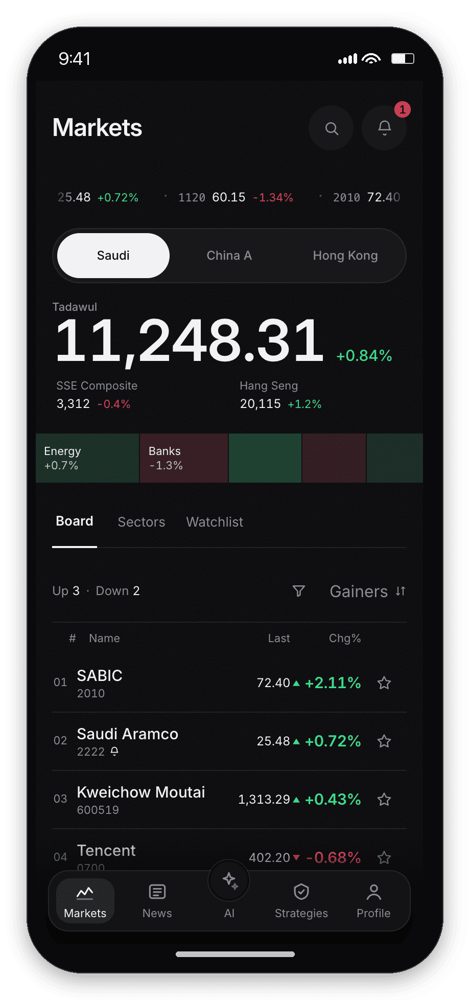
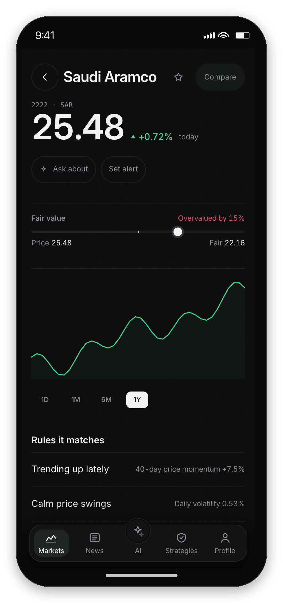
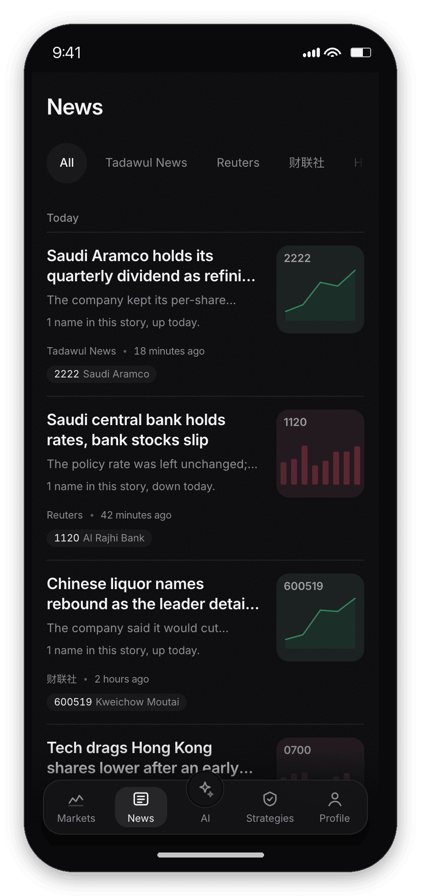
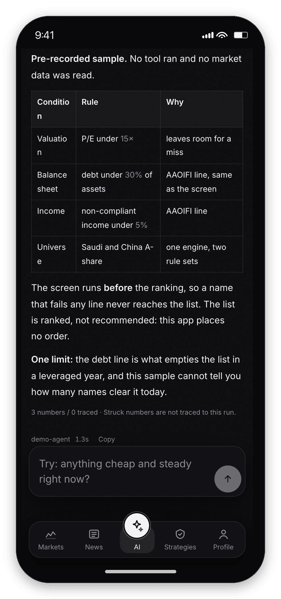
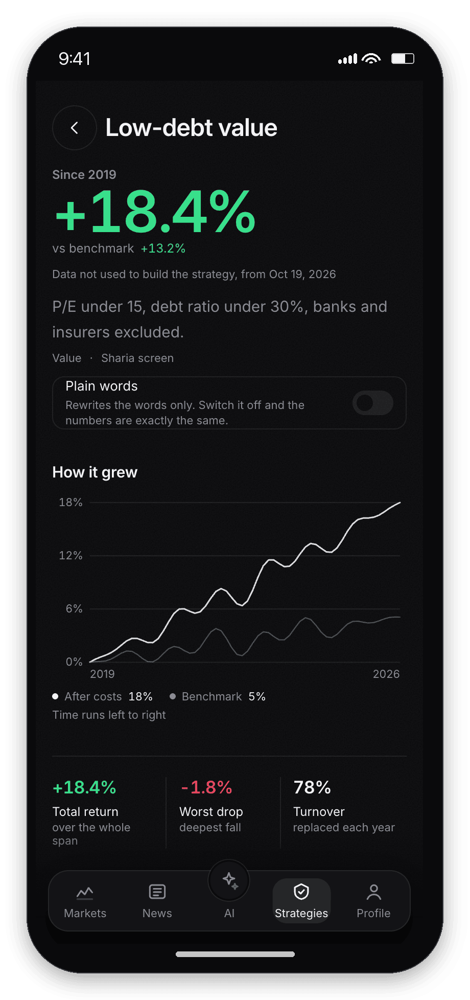
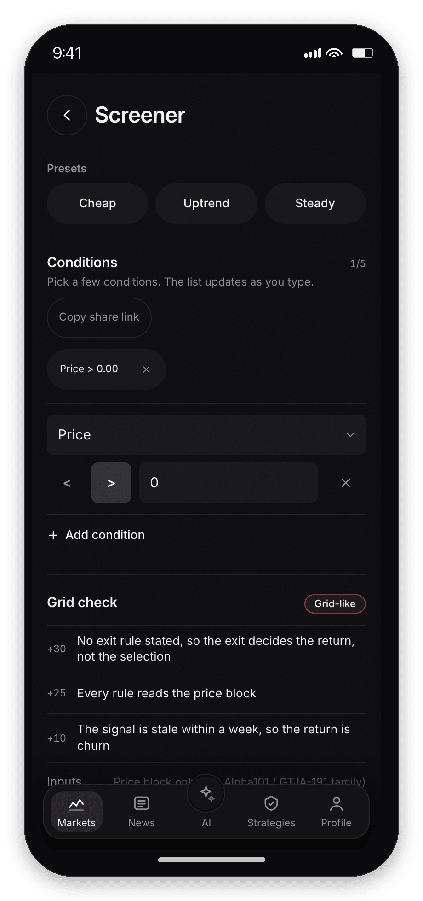
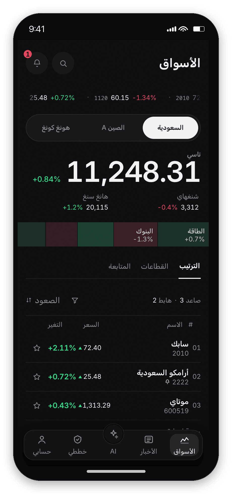
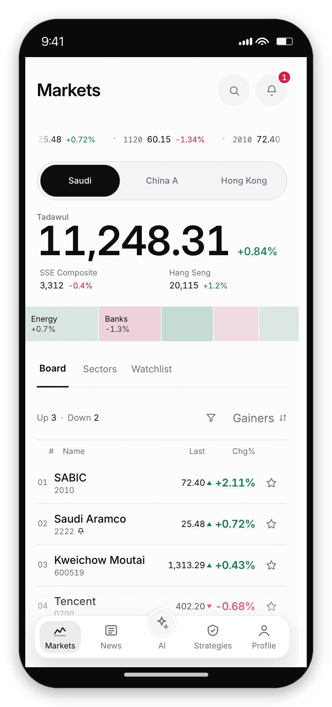
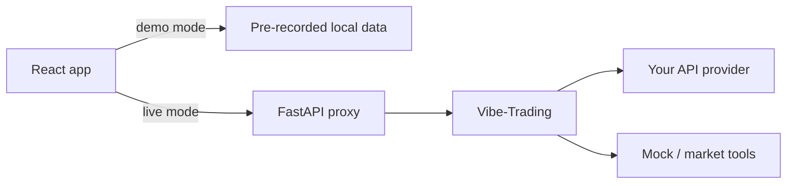
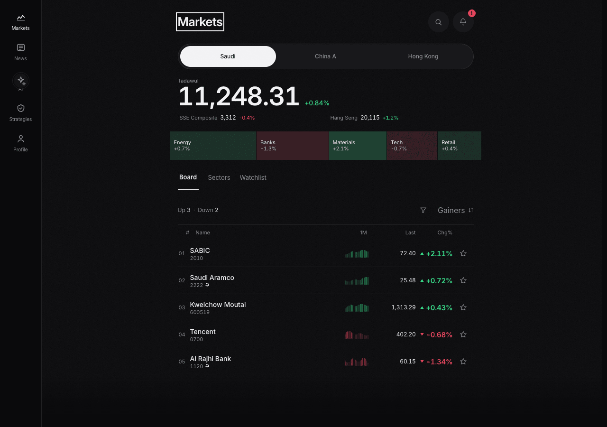

# plainquant

**Retail quant research in plain language.** Ask a question, turn it into rules,
test it on history, and read an answer that shows its evidence. English, 简体中文
and العربية, with full RTL.

| Markets | Stock | News | AI |
|---|---|---|---|
|  |  |  |  |
| <sub>masthead, sector strip, ranked list</sub> | <sub>the rules it matches</sub> | <sub>today, and the symbols it touches</sub> | <sub>rules, then every figure marked untraced</sub> |

| Strategy | Screener | Arabic | Light |
|---|---|---|---|
|  |  |  |  |
| <sub>return, curve, then the conditions</sub> | <sub>conditions, then the grid check</sub> | <sub>mirrored, Latin digits</sub> | <sub>same layout, same contrast floor</sub> |

Every image above is generated: `npm run shots` in `web/` captures the eight
screens at 390×844 and wraps each in a phone body, so the set can be rebuilt
instead of hand-edited.

Demo-first, no provider key required. It is **not** a broker, an execution system,
or investment advice, and no order is ever placed.

## The demo in sixty seconds

No network, no key, no login — the app opens in demo mode.

1. **`/`** — the index masthead, the sector strip sized by weight, then the ranked
   list. Tap a name.
2. **`/m/2222`** — five pillars of checks, with the Sharia axis in the same
   language as the rest: pass, fail, or **missing** (never a zero).
3. **`/screener`** — press **Uptrend**: it returns nothing, and the screen says why
   (zero-result autopsy, then the one rule to relax). Press **Cheap**: it reads
   P/E and debt, and the grid check names the factor family.
4. **`/strategy/low-debt-value`** — the curve, the cost row, the deflated Sharpe,
   the grid check (path exposure, persistence) and a receipt that pins the rules
   and the assumptions.
5. **`/ai`** — ask "cheap, low debt, Sharia screen" and a pre-recorded answer
   answers in the product's own shape: a rule table, then a count of numbers with
   none traced, and every figure struck through because no run backs it. Ask for a buy call
   instead and you get a stamped refusal receipt ([screenshot](docs/screenshots/phones/phone-refusal.png)).
6. **`/ai/provider`** — connect your own model when you want the live path.

Long-press any row anywhere and its symbol becomes a chip in the AI composer, so
the question starts from the screen you were reading.

## What this is

- A cross-sectional research desk for Saudi Arabia and China.
- A **Sharia screen before ranking** product, not a compliance badge after the fact.
- A deterministic engine plus an LLM that translates and explains — the model does
  not invent the numbers.
- A demo you can run with one command, and a live path where **you** supply the API
  base URL, model and key.

## Quick start

You need macOS/Linux, Node 20+, `uv`, Python 3.12, and the Vibe-Trading CLI.

```bash
git clone https://github.com/arysaikyn/plainquant.git
cd plainquant

uv venv ~/.venvs/vibe-trading --python 3.12
uv pip install --python ~/.venvs/vibe-trading/bin/python "vibe-trading-ai==0.1.18"

./dev.sh
```

Open <http://localhost:5177>. **No API key is needed for the demo.**

`dev.sh` starts Vibe-Trading, the FastAPI proxy and Vite; Ctrl-C stops what it
started. If Vibe is not installed, `VIBE_BIN=/path/to/vibe-trading ./dev.sh`.

## Use a real model

The app opens in demo mode and makes no provider calls. To go live:

1. Open **AI → Connect API** (or **Profile → API settings**).
2. Enter the base API URL, model ID and your own key.
3. The app writes the provider config through the local proxy. The key stays in
   Vibe's local settings, never in browser storage.

Demo mode remains available with **Use demo mode**.

## What is inside

- **AI tab** — Vibe-Trading sessions, streaming, tools, run cards, stop, history,
  numeral provenance and refusal receipts.
- **Workspace** — runs, paper accounts, portfolio, alphas, schedules, model
  status, uploads, checkpoints and a weekly route sheet.
- **Screener** — presets, saved screens, five-rule builder, Sharia tri-state,
  zero-result autopsy, stale-data refusal, a fixed pipeline and a grid check that
  names the factor family every rule reads.
- **Strategies** — factor rules, equity curve, cost/significance analysis, grid
  check (path exposure and persistence), receipts, drop ledger, cross-market lens,
  pick list, jar and graveyard.
- **Review / Learn** — daily review, confidence book with Brier score, and a
  glossary that unlocks after you have actually visited the screens.

## Architecture



The browser never receives the upstream provider key. The backend allowlists the
small set of paths the UI needs.

## Rules we keep

- Sharia screening is a filter **before** ranking.
- A number without an engine field is labelled; it is not silently trusted.
- Demo data is labelled as demo.
- No execution, broker, custody, price prediction, or investment advice.
- No stop-loss, take-profit or entry-price field anywhere: exits come from the
  ranking, which is what stops a rule set from collapsing into a grid bot.
- Every screen works in English, Chinese and Arabic, including RTL.
- One type scale, and Arabic gets its own step: nothing renders below 11px (13px
  for Arabic meta), and no label is cut with an ellipsis at 320px.

## Develop

```bash
cd web
npm run typecheck
npm run lint
npm run test
npm run test:e2e
npm run design   # needs Hallmark's local sloplint; CI skips this external gate
npm run build

cd ../backend && uv run python -m unittest discover -s tests
```

`npm run test:e2e` covers the twenty-four screens in English, Arabic and Chinese,
in both themes, at 390px and at 320px, plus `axe` accessibility checks.

The market, news and strategy universe is mock data in `web/src/data/mock.ts`;
the deterministic engine is the next build. The AI and Workspace have a real
backend path when you connect a provider.

## On a desktop

The same app, same components, at 1280px:

<p align="center">
  
</p>

## Contributing

The repository is public and forking is enabled.

- **Anyone with the link** can fork, push to their fork, and open a pull request.
- **Direct push** requires write access. Open an issue with your GitHub username
  and the area you want to work on; a maintainer can invite you.
- Keep changes small, run the checks above, and include screenshots for UI work.
- Never commit `.env`, keys, raw vendor data, or generated output.

See [CONTRIBUTING.md](CONTRIBUTING.md).

## Layout

```
web/         React + Vite + Tailwind UI, demo mode, local state
backend/     FastAPI proxy, provider settings, tests
model/       the one signals contract and example
docs/        product notes, the design reference set, screenshots
dev.sh       one-command development stack
```

---

**Status:** demo-first prototype. Market/news/strategy data is mock. AI can be
demo or your provider. The deterministic engine, live Saudi feed and production
deployment are not built yet.
