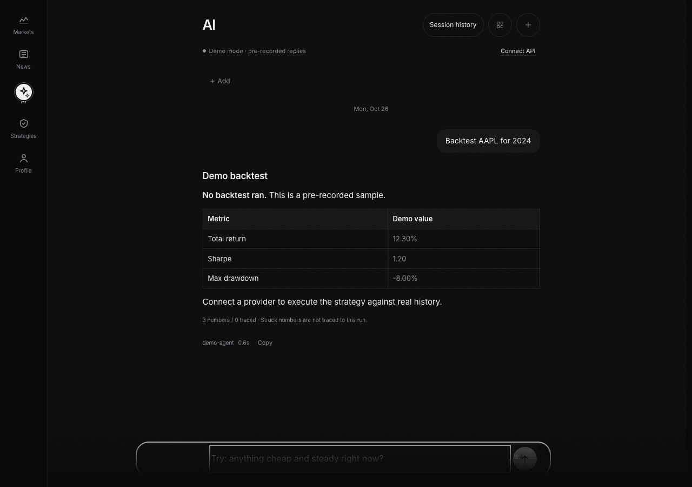
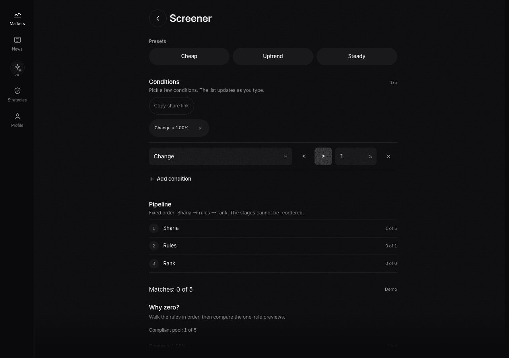
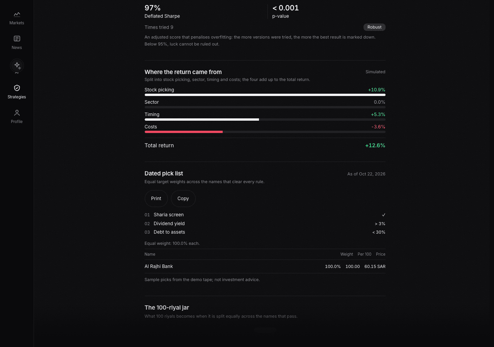
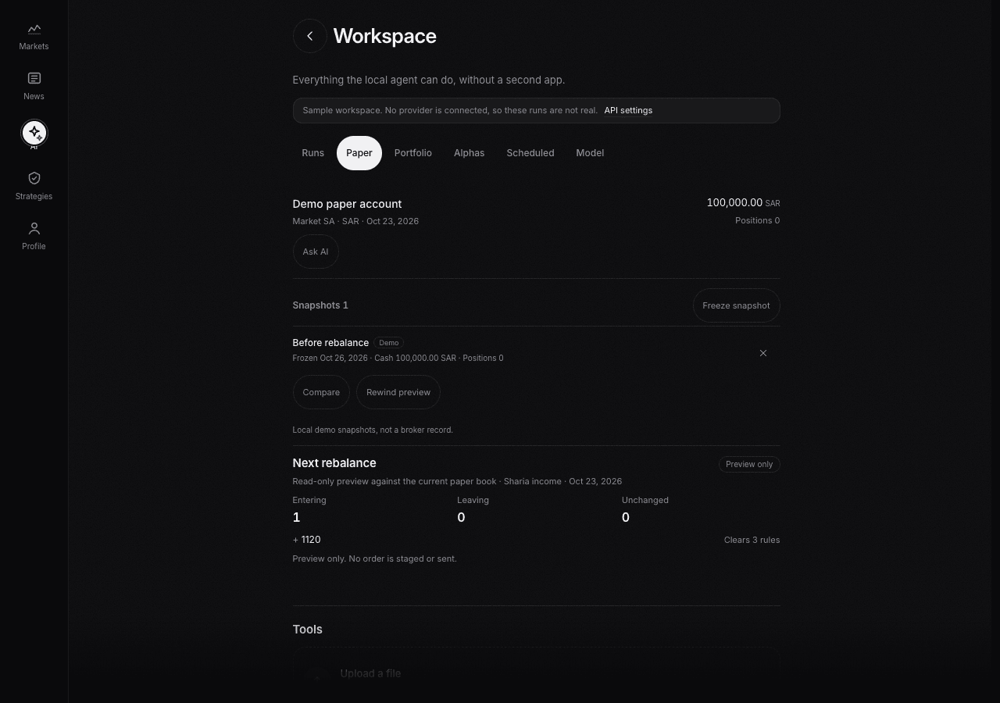
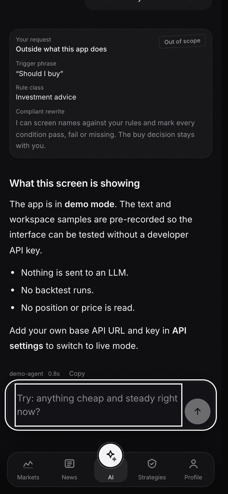
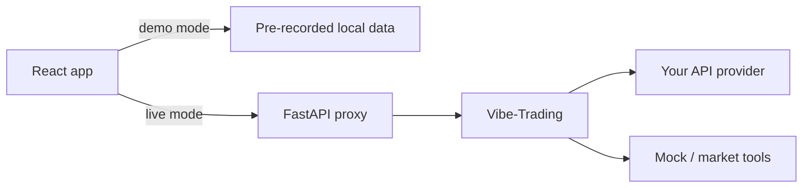

# KFUPM Quant Platform

**Retail quant research in plain language.** Ask a question, turn it into rules,
test it on history, and read an answer that shows its evidence.


Demo-first, no provider key required. English, 简体中文 and العربية, with RTL.

## What this is

- A cross-sectional research desk for Saudi Arabia and China.
- A **Sharia screen before ranking** product, not a compliance badge after the fact.
- A deterministic engine plus an LLM that translates and explains — the model
  does not invent the numbers.
- A demo you can run with one command, and a live path where **you** supply the
  API base URL, model and key.

It is **not** a broker, an execution system, or investment advice. No order is
ever placed.

## See it

| AI demo | Screener audit |
|---|---|
|  |  |
| Pre-recorded answer; numbers not traced to a run are marked. | Zero-result autopsy and the locked Sharia → rules → rank pipeline. |

| Strategy evidence | Workspace paper |
|---|---|
|  |  |
| Return attribution and a dated pick list; receipt, drop ledger and jar follow. | Local paper checkpoints and a read-only rebalance preview. |

<p align="center">
  
  <br>
  <sub>Mobile: a request for a buy/sell call gets a stamped receipt, not an answer.</sub>
</p>

## Quick start

You need macOS/Linux, Node 20+, `uv`, Python 3.12, and the Vibe-Trading CLI.

```bash
git clone https://github.com/arysaikyn/kfupm-quant-platform.git
cd kfupm-quant-platform

uv venv ~/.venvs/vibe-trading --python 3.12
uv pip install --python ~/.venvs/vibe-trading/bin/python "vibe-trading-ai==0.1.18"

./dev.sh
```

Open <http://localhost:5177>. **No API key is needed for the demo.**

`dev.sh` starts Vibe-Trading, the FastAPI proxy and Vite; Ctrl-C stops what it
started. If Vibe is not installed, `VIBE_BIN=/path/to/vibe-trading ./dev.sh`.

## Use a real model

The app opens in demo mode and makes no provider calls. To go live:

1. Open **AI → Connect API** (or **Profile → API settings**).
2. Enter the base API URL, model ID and your own key.
3. The app writes the provider config through the local proxy. The key stays in
   Vibe's local settings, never in browser storage.

Demo mode remains available with **Use demo mode**.

## What is inside

- **AI tab** — Vibe-Trading sessions, streaming, tools, run cards, stop, history,
  numeral provenance and refusal receipts.
- **Workspace** — runs, paper accounts, portfolio, alphas, schedules, model
  status, uploads, checkpoints and a weekly route sheet.
- **Screener** — presets, saved screens, five-rule builder, Sharia tri-state,
  zero-result autopsy, stale-data refusal, a fixed pipeline and a grid check
  that names the factor family every rule reads.
- **Strategies** — factor rules, equity curve, cost/significance analysis,
  grid check (path exposure and persistence), receipts, drop ledger,
  cross-market lens, pick list, jar and graveyard.
- **Review / Learn** — daily review, confidence book with Brier score, and a
  glossary that unlocks after you have actually visited the screens.

## Architecture



The browser never receives the upstream provider key. The backend allowlists the
small set of paths the UI needs.

## Rules we keep

- Sharia screening is a filter **before** ranking.
- A number without an engine field is labelled; it is not silently trusted.
- Demo data is labelled as demo.
- No execution, broker, custody, price prediction, or investment advice.
- No stop-loss, take-profit or entry-price field anywhere: exits come from the
  ranking, which is what stops a rule set from collapsing into a grid bot.
- Every screen works in English, Chinese and Arabic, including RTL.

## Develop

```bash
cd web
npm run typecheck
npm run lint
npm run test
npm run test:e2e
npm run design   # needs Hallmark's local sloplint; CI skips this external gate
npm run build

cd ../backend && uv run python -m unittest discover -s tests
```

The market, news and strategy universe is mock data in `web/src/data/mock.ts`;
the deterministic engine is the next build. The AI and Workspace have a real
backend path when you connect a provider.

## Contributing

The repository is public and forking is enabled.

- **Anyone with the link** can fork, push to their fork, and open a pull request.
- **Direct push** requires write access. Open an issue with your GitHub username
  and the area you want to work on; a maintainer can invite you.
- Keep changes small, run the checks above, and include screenshots for UI work.
- Never commit `.env`, keys, raw vendor data, or generated output.

See [CONTRIBUTING.md](CONTRIBUTING.md).

## Layout

```
web/         React + Vite + Tailwind UI, demo mode, local state
backend/     FastAPI proxy, provider settings, tests
model/       the one signals contract and example
docs/        product notes and README screenshots
dev.sh       one-command development stack
```

---

**Status:** demo-first prototype. Market/news/strategy data is mock. AI can be
demo or your provider. The deterministic engine, live Saudi feed and production
deployment are not built yet.
