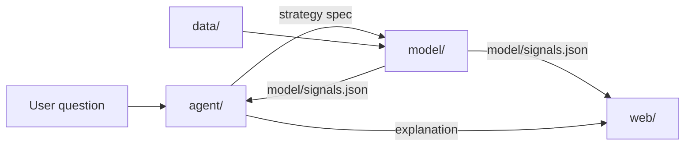

# Architecture

## Shape

## Components

### `data/`

Owner lane: data.

Ingests vendor data, normalizes it, and stores it point-in-time. Output: bars, fundamentals, corporate actions, trading calendar, and delisting flags.

Rules:

- Raw vendor data stays local. It is not committed and not redistributed.
- Every row carries the date on which it became known.
- A missing value stays missing. The pipeline does not fill it with zero.

### `model/`

Owner lane: model.

- `factors/`: pure functions from a data snapshot to a cross-sectional score.
- `screens/`: filters, including the Sharia screen.
- `backtest/`: portfolio construction, costs, and metrics.
- A run entry point accepts a strategy spec and writes `model/signals.json`.

Rules:

- Deterministic. The same spec and the same data snapshot produce the same output.
- The universe is point-in-time. Delisted stocks stay in the history.
- The output is one file, validated against `signals.schema.json`.

### `agent/`

Owner lane: agent.

Translates a question into a strategy spec, calls the model, and explains the result.

Rules:

- The language model never computes, estimates, or restates a number that is not in `model/signals.json`.
- If the question cannot map to a spec, the agent says so and asks. It does not guess a factor.
- The strategy spec is shown to the user before the run.

### `web/`

Owner lane: web.

Chat plus result views. It reads `model/signals.json` for every number and the agent response for prose.

Rules:

- `web/` does not import `model/` or `data/`.
- Every number on screen comes from the signals file.
- A missing file is an explicit empty state, not a zero.

## Data flow

1. The user asks a question in `web/`.
2. `agent/` returns a strategy spec and shows it to the user.
3. `model/` validates the spec, runs the backtest, and writes `model/signals.json`.
4. `agent/` reads the file and writes the explanation.
5. `web/` renders the numbers from the file and the prose from the agent.

## Invariants

1. **Numbers are deterministic.** The engine computes every number. The model explains.
2. **Point-in-time.** A backtest uses only data known on the decision date.
3. **One contract.** The web reads `model/signals.json` and nothing else for data.
4. **One engine, per-market config.** Market differences live in config: universe, calendar, costs, and Sharia rules. They do not fork the engine.
5. **Explanations are prose.** They live in the agent response, not in the numbers contract.
6. **No silent fallback.** Missing data, a failed factor, or an invalid spec stops the run with a warning. It does not degrade to a default.

## Build order

1. The contract and its example.
2. One data snapshot and one factor.
3. A backtest that writes a valid signals file.
4. The agent translation and explanation.
5. The web view.

Do not build the UI against a guessed file. Build against the schema.

## Boundaries

- A component reads another component's output through the contract only.
- `web/` does not import `model/` or `data/`.
- `agent/` does not import `data/` or compute factors.
- A cross-boundary change needs both owners in the same task.
